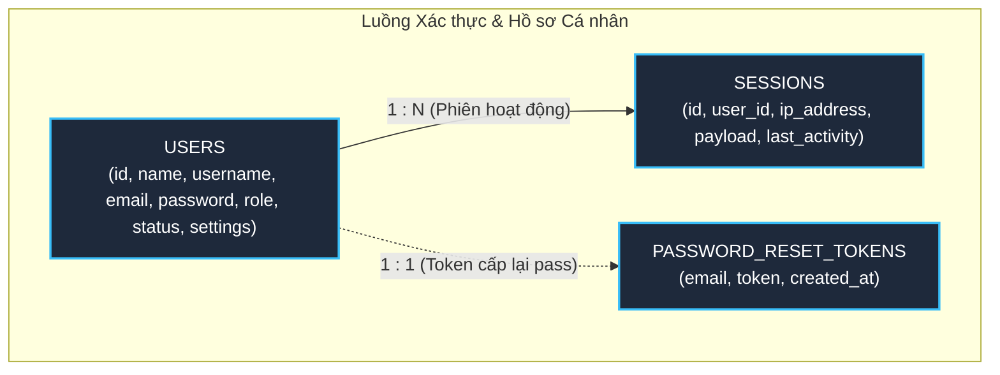
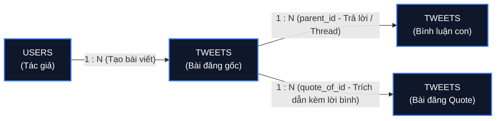
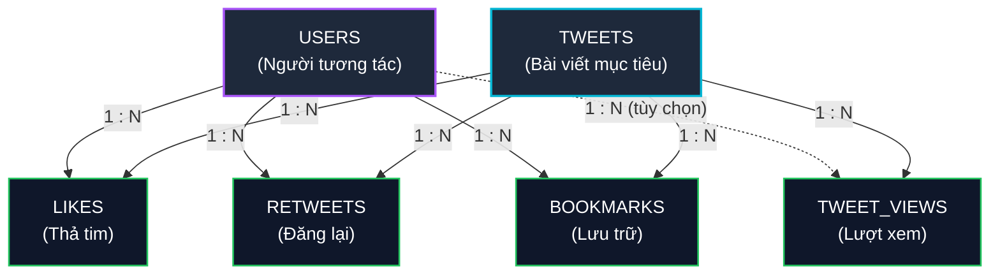
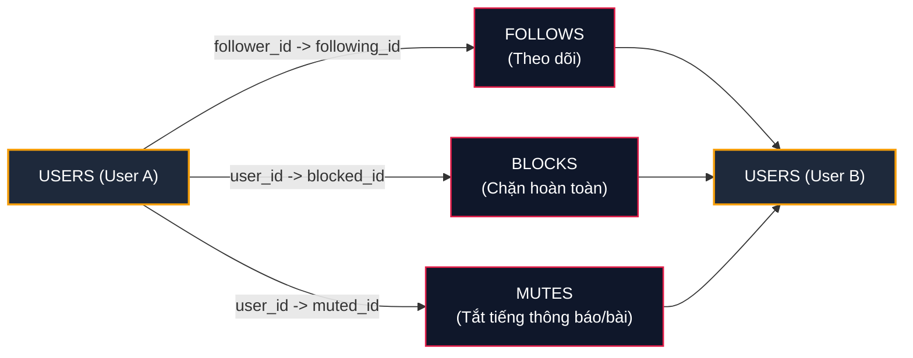
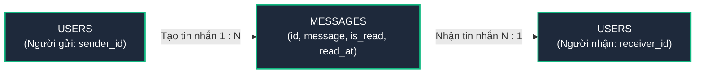
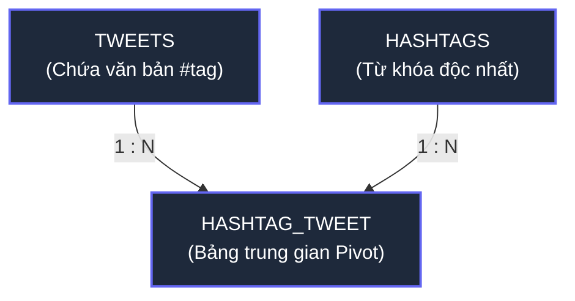
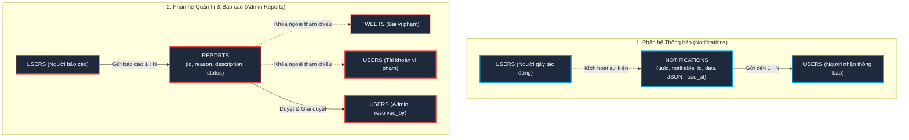
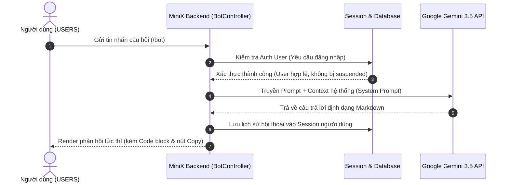
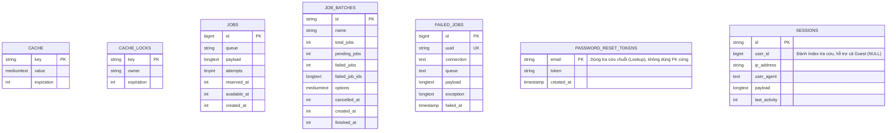

# 📊 SƠ ĐỒ DATABASE VÀ SƠ ĐỒ ERD DỰ ÁN MINIX (X / TWITTER CLONE)

> **Tài liệu đặc tả kiến trúc cơ sở dữ liệu và mô hình thực thể mối quan hệ (ERD)**  
> **Dự án:** MiniX – Mạng xã hội X.com (Twitter) Full-Stack  
> **Công nghệ áp dụng:** Laravel 12, MySQL (MariaDB), Vue 3, Inertia.js  
> **Cam kết:** Dữ liệu chuẩn xác 100% theo các migration và Eloquent Models thực tế của dự án, không thêm bớt sai lệch.

---

## 📑 MỤC LỤC
1. [PHẦN 1: SƠ ĐỒ VÀ MỐI QUAN HỆ CỦA CÁC BẢNG TRONG DATABASE](#phần-1-sơ-đồ-và-mối-quan-hệ-của-các-bảng-trong-database)
   - 1.1. Sơ đồ liên kết vật lý toàn bộ Database (Physical Database Schema)
   - 1.2. Đặc tả chi tiết các bảng trong cơ sở dữ liệu (Data Dictionary)
   - 1.3. Bảng tổng hợp các ràng buộc khóa ngoại (Foreign Key Constraints)
2. [PHẦN 2: SƠ ĐỒ ERD CÁC CHỨC NĂNG CHÍNH CỦA DỰ ÁN](#phần-2-sơ-đồ-erd-các-chức-năng-chính-của-dự-án)
   - 2.1. Phân hệ 1: Xác thực, Phân quyền & Hồ sơ cá nhân (User & Profile Management)
   - 2.2. Phân hệ 2: Quản lý Bài viết, Cây bình luận đa cấp & Trích dẫn (Tweets, Threads & Quotes)
   - 2.3. Phân hệ 3: Tương tác Xã hội (Likes, Retweets, Bookmarks, Views Analytics)
   - 2.4. Phân hệ 4: Mạng lưới Kết nối (Follows, Blocks, Mutes)
   - 2.5. Phân hệ 5: Hộp thư Nhắn tin trực tiếp 1-1 (Direct Messaging)
   - 2.6. Phân hệ 6: Xu hướng & Hashtags (#Trending Engine)
   - 2.7. Phân hệ 7: Trung tâm Thông báo & Báo cáo Quản trị (Notifications & Admin Moderation)
   - 2.8. Phân hệ 8: Trợ lý Trí tuệ Nhân tạo (MiniX AI Bot Assistant)
3. [QUY TẮC RÀNG BUỘC TOÀN VẸN VÀ LOGIC NGHIỆP VỤ (BUSINESS RULES)](#quy-tắc-ràng-buộc-toàn-vẹn-và-logic-nghiệp-vụ)
4. [PHẦN 3: CÁC BẢNG ĐỨNG ĐỘC LẬP / HẠ TẦNG KỸ THUẬT CỦA FRAMEWORK](#phần-3-các-bảng-đứng-độc-lập--hạ-tầng-kỹ-thuật-của-framework)
   - 4.1. Bản chất và lý do xuất hiện các bảng đứng riêng lẻ
   - 4.2. Sơ đồ các bảng độc lập / hạ tầng kỹ thuật (System Infrastructure Schema)
   - 4.3. Đặc tả chi tiết từng bảng độc lập và vai trò vận hành
   - 4.4. Đánh giá tính chuẩn mực trong đồ án phần mềm

---

# PHẦN 1: SƠ ĐỒ VÀ MỐI QUAN HỆ CỦA CÁC BẢNG TRONG DATABASE

Hệ thống cơ sở dữ liệu của MiniX bao gồm **14 bảng nghiệp vụ cốt lõi** (phục vụ chức năng mạng xã hội) và **7 bảng hạ tầng kỹ thuật độc lập** do framework Laravel 12 quản lý (`cache`, `cache_locks`, `jobs`, `job_batches`, `failed_jobs`, `sessions`, `password_reset_tokens`).

### 1.1. Sơ đồ liên kết vật lý toàn bộ Database (Physical Database Schema)

Dưới đây là sơ đồ quan hệ thực thể biểu diễn chính xác cấu trúc bảng, các trường khóa chính (PK), khóa ngoại (FK) và đường nối giữa các bảng:

```mermaid
erDiagram
    USERS ||--o{ TWEETS : "creates (1:N)"
    USERS ||--o{ LIKES : "places (1:N)"
    USERS ||--o{ RETWEETS : "reposts (1:N)"
    USERS ||--o{ BOOKMARKS : "saves (1:N)"
    USERS ||--o{ TWEET_VIEWS : "views (1:N)"
    USERS ||--o{ FOLLOWS : "follower (1:N)"
    USERS ||--o{ FOLLOWS : "following (1:N)"
    USERS ||--o{ BLOCKS : "blocker (1:N)"
    USERS ||--o{ BLOCKS : "blocked (1:N)"
    USERS ||--o{ MUTES : "muter (1:N)"
    USERS ||--o{ MUTES : "muted (1:N)"
    USERS ||--o{ MESSAGES : "sends (1:N)"
    USERS ||--o{ MESSAGES : "receives (1:N)"
    USERS ||--o{ NOTIFICATIONS : "receives_morph (1:N)"
    USERS ||--o{ REPORTS : "reporter (1:N)"
    USERS ||--o{ REPORTS : "reported_user (1:N)"
    USERS ||--o{ REPORTS : "resolved_by (1:N)"
    USERS ||--o{ SESSIONS : "owns (1:N)"

    TWEETS ||--o{ TWEETS : "parent_thread (1:N self)"
    TWEETS ||--o{ TWEETS : "quote_of (1:N self)"
    TWEETS ||--o{ LIKES : "receives_likes (1:N)"
    TWEETS ||--o{ RETWEETS : "receives_retweets (1:N)"
    TWEETS ||--o{ BOOKMARKS : "receives_bookmarks (1:N)"
    TWEETS ||--o{ TWEET_VIEWS : "has_views (1:N)"
    TWEETS ||--o{ HASHTAG_TWEET : "tagged_in (1:N)"
    TWEETS ||--o{ REPORTS : "reported_in (1:N)"

    HASHTAGS ||--o{ HASHTAG_TWEET : "has_tweets (1:N)"

    USERS {
        bigint id PK
        string name
        string username UK
        string email UK
        timestamp email_verified_at
        string password
        enum role "user, admin"
        enum status "active, suspended"
        json settings
        timestamp deactivated_at
        text bio
        string avatar_path
        string banner_path
        string location
        string website
        date birthdate
        string remember_token
        timestamp created_at
        timestamp updated_at
    }

    TWEETS {
        bigint id PK
        bigint user_id FK
        bigint parent_id FK "nullable (Reply thread)"
        bigint quote_of_id FK "nullable (Quote post)"
        text tweet
        string file "nullable"
        boolean is_video "nullable"
        unsigned_bigint views_count "default 0"
        timestamp created_at
        timestamp updated_at
    }

    LIKES {
        bigint id PK
        bigint user_id FK
        bigint tweet_id FK
        timestamp created_at
        timestamp updated_at
    }

    RETWEETS {
        bigint id PK
        bigint user_id FK
        bigint tweet_id FK
        timestamp created_at
        timestamp updated_at
    }

    BOOKMARKS {
        bigint id PK
        bigint user_id FK
        bigint tweet_id FK
        timestamp created_at
        timestamp updated_at
    }

    TWEET_VIEWS {
        bigint id PK
        bigint tweet_id FK
        bigint user_id FK "nullable"
        string ip_address
        string session_id
        timestamp created_at
        timestamp updated_at
    }

    FOLLOWS {
        bigint id PK
        bigint follower_id FK
        bigint following_id FK
        timestamp created_at
        timestamp updated_at
    }

    BLOCKS {
        bigint id PK
        bigint user_id FK
        bigint blocked_id FK
        timestamp created_at
        timestamp updated_at
    }

    MUTES {
        bigint id PK
        bigint user_id FK
        bigint muted_id FK
        timestamp created_at
        timestamp updated_at
    }

    MESSAGES {
        bigint id PK
        bigint sender_id FK
        bigint receiver_id FK
        text message
        boolean is_read "default false"
        timestamp read_at "nullable"
        timestamp created_at
        timestamp updated_at
    }

    HASHTAGS {
        bigint id PK
        string tag UK
        timestamp created_at
        timestamp updated_at
    }

    HASHTAG_TWEET {
        bigint id PK
        bigint hashtag_id FK
        bigint tweet_id FK
        timestamp created_at
        timestamp updated_at
    }

    REPORTS {
        bigint id PK
        bigint reporter_id FK
        bigint tweet_id FK "nullable"
        bigint reported_user_id FK "nullable"
        string reason
        text description "nullable"
        enum status "pending, resolved, dismissed"
        text admin_note "nullable"
        bigint resolved_by FK "nullable"
        timestamp resolved_at "nullable"
        timestamp created_at
        timestamp updated_at
    }

    NOTIFICATIONS {
        uuid id PK
        string type
        string notifiable_type
        unsigned_bigint notifiable_id
        text data
        timestamp read_at "nullable"
        timestamp created_at
        timestamp updated_at
    }

    SESSIONS {
        string id PK
        bigint user_id FK "nullable"
        string ip_address "nullable"
        text user_agent "nullable"
        longtext payload
        int last_activity
    }

    PASSWORD_RESET_TOKENS {
        string email PK
        string token
        timestamp created_at
    }
```

---

### 1.2. Đặc tả chi tiết các bảng trong cơ sở dữ liệu (Data Dictionary)

#### 1. Bảng `users` (Người dùng hệ thống)
Lưu trữ thông tin tài khoản, hồ sơ cá nhân, cài đặt bảo mật và quyền hạn.
| Tên cột | Kiểu dữ liệu | Khóa | Nullable | Mặc định | Mô tả ý nghĩa |
|---|---|:---:|:---:|:---:|---|
| `id` | `BIGINT UNSIGNED` | **PK** | Không | Auto Increment | Định danh duy nhất của người dùng |
| `name` | `VARCHAR(255)` | | Không | | Tên hiển thị (Display Name) |
| `username` | `VARCHAR(30)` | **UK** | Có | `NULL` | Tên người dùng dạng `@handle` (độc nhất) |
| `email` | `VARCHAR(255)` | **UK** | Không | | Địa chỉ hòm thư điện tử (độc nhất) |
| `email_verified_at` | `TIMESTAMP` | | Có | `NULL` | Thời điểm xác thực email qua link Gmail |
| `password` | `VARCHAR(255)` | | Không | | Mật khẩu tài khoản (Bcrypt băm an toàn) |
| `role` | `ENUM('user','admin')` | | Không | `'user'` | Vai trò: Người dùng thường hoặc Quản trị viên |
| `status` | `ENUM('active','suspended')` | | Không | `'active'` | Trạng thái tài khoản: Đang hoạt động / Bị khóa |
| `settings` | `JSON` | | Có | `NULL` | Cấu hình riêng tư, lọc thông báo, chất lượng |
| `deactivated_at` | `TIMESTAMP` | | Có | `NULL` | Thời điểm vô hiệu hóa tạm thời tài khoản |
| `bio` | `TEXT` | | Có | `NULL` | Tiểu sử giới thiệu bản thân |
| `avatar_path` | `VARCHAR(255)` | | Có | `NULL` | Đường dẫn file ảnh đại diện (avatar) |
| `banner_path` | `VARCHAR(255)` | | Có | `NULL` | Đường dẫn file ảnh bìa (header banner) |
| `location` | `VARCHAR(255)` | | Có | `NULL` | Vị trí địa lý / Thành phố |
| `website` | `VARCHAR(255)` | | Có | `NULL` | Địa chỉ website liên kết |
| `birthdate` | `DATE` | | Có | `NULL` | Ngày sinh người dùng |
| `remember_token` | `VARCHAR(100)` | | Có | `NULL` | Token ghi nhớ phiên đăng nhập |
| `created_at` | `TIMESTAMP` | | Có | `NULL` | Ngày đăng ký tài khoản |
| `updated_at` | `TIMESTAMP` | | Có | `NULL` | Ngày cập nhật thông tin gần nhất |

---

#### 2. Bảng `tweets` (Bài đăng & Bình luận đa cấp)
Lưu bài tweet gốc, tweet trả lời (reply) và tweet trích dẫn (quote).
| Tên cột | Kiểu dữ liệu | Khóa | Nullable | Mặc định | Mô tả ý nghĩa |
|---|---|:---:|:---:|:---:|---|
| `id` | `BIGINT UNSIGNED` | **PK** | Không | Auto Increment | Mã định danh bài viết |
| `user_id` | `BIGINT UNSIGNED` | **FK** | Không | | Tác giả bài đăng $\rightarrow$ `users.id` |
| `parent_id` | `BIGINT UNSIGNED` | **FK** | Có | `NULL` | Bài viết cha nếu đây là bình luận $\rightarrow$ `tweets.id` |
| `quote_of_id` | `BIGINT UNSIGNED` | **FK** | Có | `NULL` | Bài viết gốc được trích dẫn $\rightarrow$ `tweets.id` |
| `tweet` | `TEXT` | | Không | | Nội dung văn bản bài đăng (chứa text, #tag, @mention) |
| `file` | `VARCHAR(255)` | | Có | `NULL` | Đường dẫn file ảnh/video đính kèm lưu tại storage |
| `is_video` | `TINYINT(1)` | | Có | `NULL` | Đánh dấu: `1` (video), `0` hoặc `null` (hình ảnh) |
| `views_count` | `BIGINT UNSIGNED` | | Không | `0` | Tổng số lượt xem tích lũy của bài đăng |
| `created_at` | `TIMESTAMP` | | Có | `NULL` | Thời điểm đăng bài |
| `updated_at` | `TIMESTAMP` | | Có | `NULL` | Thời điểm sửa bài gần nhất |

---

#### 3. Bảng `likes` (Lượt thả tim / thích)
| Tên cột | Kiểu dữ liệu | Khóa | Nullable | Mô tả ý nghĩa |
|---|---|:---:|:---:|---|
| `id` | `BIGINT UNSIGNED` | **PK** | Không | Định danh lượt like |
| `user_id` | `BIGINT UNSIGNED` | **FK** | Không | Người bấm like $\rightarrow$ `users.id` |
| `tweet_id` | `BIGINT UNSIGNED` | **FK** | Không | Bài viết được like $\rightarrow$ `tweets.id` |
| `created_at` / `updated_at` | `TIMESTAMP` | | Có | Thời gian thực hiện tương tác |
> **Ràng buộc:** `UNIQUE(user_id, tweet_id)` – Mỗi người chỉ được thích 1 bài viết một lần.

---

#### 4. Bảng `retweets` (Lượt đăng lại bài viết)
| Tên cột | Kiểu dữ liệu | Khóa | Nullable | Mô tả ý nghĩa |
|---|---|:---:|:---:|---|
| `id` | `BIGINT UNSIGNED` | **PK** | Không | Định danh lượt retweet |
| `user_id` | `BIGINT UNSIGNED` | **FK** | Không | Người bấm đăng lại $\rightarrow$ `users.id` |
| `tweet_id` | `BIGINT UNSIGNED` | **FK** | Không | Bài viết được đăng lại $\rightarrow$ `tweets.id` |
| `created_at` / `updated_at` | `TIMESTAMP` | | Có | Thời gian thực hiện tương tác |
> **Ràng buộc:** `UNIQUE(user_id, tweet_id)` – Mỗi người chỉ retweet 1 bài viết một lần (toggle on/off).

---

#### 5. Bảng `bookmarks` (Lưu bài viết đánh dấu)
| Tên cột | Kiểu dữ liệu | Khóa | Nullable | Mô tả ý nghĩa |
|---|---|:---:|:---:|---|
| `id` | `BIGINT UNSIGNED` | **PK** | Không | Định danh lượt bookmark |
| `user_id` | `BIGINT UNSIGNED` | **FK** | Không | Người lưu bài viết $\rightarrow$ `users.id` |
| `tweet_id` | `BIGINT UNSIGNED` | **FK** | Không | Bài viết được lưu vào bộ sưu tập $\rightarrow$ `tweets.id` |
| `created_at` / `updated_at` | `TIMESTAMP` | | Có | Thời gian lưu |
> **Ràng buộc:** `UNIQUE(user_id, tweet_id)` – Đảm bảo danh sách bookmark không bị trùng lặp bài viết.

---

#### 6. Bảng `tweet_views` (Nhật ký lượt xem bài đăng)
| Tên cột | Kiểu dữ liệu | Khóa | Nullable | Mô tả ý nghĩa |
|---|---|:---:|:---:|---|
| `id` | `BIGINT UNSIGNED` | **PK** | Không | Định danh lượt view |
| `tweet_id` | `BIGINT UNSIGNED` | **FK** | Không | Bài viết được xem $\rightarrow$ `tweets.id` |
| `user_id` | `BIGINT UNSIGNED` | **FK** | Có | Người xem (nếu đã đăng nhập) $\rightarrow$ `users.id` |
| `ip_address` | `VARCHAR(45)` | | Có | Địa chỉ IPv4 / IPv6 của người xem |
| `session_id` | `VARCHAR(40)` | | Có | Mã phiên trình duyệt của người xem |
| `created_at` / `updated_at` | `TIMESTAMP` | | Có | Thời điểm ghi nhận lượt xem |

---

#### 7. Bảng `follows` (Mối quan hệ Theo dõi)
| Tên cột | Kiểu dữ liệu | Khóa | Nullable | Mô tả ý nghĩa |
|---|---|:---:|:---:|---|
| `id` | `BIGINT UNSIGNED` | **PK** | Không | Định danh quan hệ follow |
| `follower_id` | `BIGINT UNSIGNED` | **FK** | Không | Người chủ động nhấn Theo dõi $\rightarrow$ `users.id` |
| `following_id` | `BIGINT UNSIGNED` | **FK** | Không | Người được theo dõi $\rightarrow$ `users.id` |
| `created_at` / `updated_at` | `TIMESTAMP` | | Có | Thời điểm bắt đầu follow |
> **Ràng buộc:** `UNIQUE(follower_id, following_id)` – Không thể follow 1 người nhiều lần.

---

#### 8. Bảng `blocks` (Chặn người dùng)
| Tên cột | Kiểu dữ liệu | Khóa | Nullable | Mô tả ý nghĩa |
|---|---|:---:|:---:|---|
| `id` | `BIGINT UNSIGNED` | **PK** | Không | Định danh lệnh chặn |
| `user_id` | `BIGINT UNSIGNED` | **FK** | Không | Người thực hiện hành vi chặn $\rightarrow$ `users.id` |
| `blocked_id` | `BIGINT UNSIGNED` | **FK** | Không | Người bị chặn $\rightarrow$ `users.id` |
| `created_at` / `updated_at` | `TIMESTAMP` | | Có | Thời gian chặn |
> **Ràng buộc:** `UNIQUE(user_id, blocked_id)`. Khi bị block, 2 bên sẽ không thấy bài và không nhắn tin được cho nhau.

---

#### 9. Bảng `mutes` (Tắt tiếng người dùng)
| Tên cột | Kiểu dữ liệu | Khóa | Nullable | Mô tả ý nghĩa |
|---|---|:---:|:---:|---|
| `id` | `BIGINT UNSIGNED` | **PK** | Không | Định danh lệnh tắt tiếng |
| `user_id` | `BIGINT UNSIGNED` | **FK** | Không | Người cài đặt tắt tiếng $\rightarrow$ `users.id` |
| `muted_id` | `BIGINT UNSIGNED` | **FK** | Không | Người bị tắt tiếng $\rightarrow$ `users.id` |
| `created_at` / `updated_at` | `TIMESTAMP` | | Có | Thời gian tắt tiếng |
> **Ràng buộc:** `UNIQUE(user_id, muted_id)`. Ẩn bài của người bị mute khỏi Feed nhưng không chặn kết nối.

---

#### 10. Bảng `messages` (Tin nhắn trực tiếp 1-1)
| Tên cột | Kiểu dữ liệu | Khóa | Nullable | Mô tả ý nghĩa |
|---|---|:---:|:---:|---|
| `id` | `BIGINT UNSIGNED` | **PK** | Không | Mã định danh tin nhắn |
| `sender_id` | `BIGINT UNSIGNED` | **FK** | Không | Người gửi tin nhắn $\rightarrow$ `users.id` |
| `receiver_id` | `BIGINT UNSIGNED` | **FK** | Không | Người nhận tin nhắn $\rightarrow$ `users.id` |
| `message` | `TEXT` | | Không | Nội dung văn bản tin nhắn |
| `is_read` | `TINYINT(1)` | | Không | Trạng thái: `0` (chưa đọc), `1` (đã xem) |
| `read_at` | `TIMESTAMP` | | Có | Thời điểm người nhận mở xem tin nhắn |
| `created_at` / `updated_at` | `TIMESTAMP` | | Có | Thời điểm gửi tin nhắn |

---

#### 11. Bảng `hashtags` & `hashtag_tweet` (Hệ thống từ khóa xu hướng)
* **Bảng `hashtags`:**
  | Tên cột | Kiểu dữ liệu | Khóa | Nullable | Mô tả |
  |---|---|:---:|:---:|---|
  | `id` | `BIGINT UNSIGNED` | **PK** | Không | Mã định danh hashtag |
  | `tag` | `VARCHAR(255)` | **UK** | Không | Tên nhãn hashtag (không dấu `#`, ví dụ: `laravel`, `ai`) |
  | `created_at` / `updated_at` | `TIMESTAMP` | | Có | Thời gian tạo |

* **Bảng trung gian `hashtag_tweet` (N:M Pivot Table):**
  | Tên cột | Kiểu dữ liệu | Khóa | Nullable | Mô tả |
  |---|---|:---:|:---:|---|
  | `id` | `BIGINT UNSIGNED` | **PK** | Không | Khóa chính bảng phụ |
  | `hashtag_id` | `BIGINT UNSIGNED` | **FK** | Không | Khóa ngoại trỏ về $\rightarrow$ `hashtags.id` (Cascade) |
  | `tweet_id` | `BIGINT UNSIGNED` | **FK** | Không | Khóa ngoại trỏ về $\rightarrow$ `tweets.id` (Cascade) |
  | `created_at` / `updated_at` | `TIMESTAMP` | | Có | Thời gian liên kết |
  > **Ràng buộc:** `UNIQUE(hashtag_id, tweet_id)`.

---

#### 12. Bảng `reports` (Báo cáo vi phạm nội dung / tài khoản)
| Tên cột | Kiểu dữ liệu | Khóa | Nullable | Mô tả ý nghĩa |
|---|---|:---:|:---:|---|
| `id` | `BIGINT UNSIGNED` | **PK** | Không | Mã định danh báo cáo |
| `reporter_id` | `BIGINT UNSIGNED` | **FK** | Không | Người gửi báo cáo $\rightarrow$ `users.id` |
| `tweet_id` | `BIGINT UNSIGNED` | **FK** | Có | Bài viết bị báo cáo $\rightarrow$ `tweets.id` (nếu có) |
| `reported_user_id` | `BIGINT UNSIGNED` | **FK** | Có | Tài khoản bị báo cáo $\rightarrow$ `users.id` (nếu có) |
| `reason` | `VARCHAR(255)` | | Không | Phân loại lý do: `spam`, `harassment`, `hate_speech`... |
| `description` | `TEXT` | | Có | Mô tả chi tiết hành vi vi phạm |
| `status` | `ENUM('pending','resolved','dismissed')` | | Không | Trạng thái xử lý của Admin (mặc định: `pending`) |
| `admin_note` | `TEXT` | | Có | Ghi chú phản hồi của Admin khi duyệt |
| `resolved_by` | `BIGINT UNSIGNED` | **FK** | Có | Admin trực tiếp xử lý báo cáo $\rightarrow$ `users.id` |
| `resolved_at` | `TIMESTAMP` | | Có | Thời điểm giải quyết báo cáo |
| `created_at` / `updated_at` | `TIMESTAMP` | | Có | Thời gian tạo báo cáo |

---

#### 13. Bảng `notifications` (Trung tâm thông báo tự động)
Áp dụng cấu trúc **Polymorphic Relation** chuẩn của Laravel:
| Tên cột | Kiểu dữ liệu | Khóa | Nullable | Mô tả ý nghĩa |
|---|---|:---:|:---:|---|
| `id` | `CHAR(36)` (UUID) | **PK** | Không | Khóa chính dạng chuỗi định danh toàn cầu UUID |
| `type` | `VARCHAR(255)` | | Không | Class thông báo (`App\Notifications\AppActivityNotification`) |
| `notifiable_type` | `VARCHAR(255)` | | Không | Đối tượng nhận (`App\Models\User`) |
| `notifiable_id` | `BIGINT UNSIGNED` | | Không | ID người nhận thông báo (`users.id`) |
| `data` | `TEXT` | | Không | Dữ liệu JSON chứa: `sender_id`, `sender_name`, `action` (like/retweet/reply/follow), `tweet_id`... |
| `read_at` | `TIMESTAMP` | | Có | Thời điểm đã đọc (Null = Chưa đọc, hiện chấm xanh) |
| `created_at` / `updated_at` | `TIMESTAMP` | | Có | Thời gian gửi thông báo |

---

### 1.3. Bảng tổng hợp các ràng buộc khóa ngoại (Foreign Key Constraints)

Hệ thống thiết lập cơ chế **Toàn vẹn tham chiếu (Referential Integrity)** tự động xử lý khi bản ghi cha bị xóa:

| Bảng con | Khóa ngoại (FK) | Bảng cha | Khóa chính (PK) | Hành vi khi bản ghi cha bị XÓA (`ON DELETE`) |
|---|---|---|---|---|
| `tweets` | `user_id` | `users` | `id` | **CASCADE** (Xóa user $\rightarrow$ xóa toàn bộ tweet của user) |
| `tweets` | `parent_id` | `tweets` | `id` | **CASCADE** (Xóa tweet cha $\rightarrow$ tự động xóa sạch thread con) |
| `tweets` | `quote_of_id` | `tweets` | `id` | **SET NULL** (Xóa tweet gốc $\rightarrow$ tweet quote giữ nguyên text, card quote chuyển "Bài viết đã bị xóa") |
| `likes` | `user_id` | `users` | `id` | **CASCADE** |
| `likes` | `tweet_id` | `tweets` | `id` | **CASCADE** (Xóa tweet $\rightarrow$ xóa lượt like) |
| `retweets` | `user_id` | `users` | `id` | **CASCADE** |
| `retweets` | `tweet_id` | `tweets` | `id` | **CASCADE** (Xóa tweet $\rightarrow$ xóa lượt retweet) |
| `bookmarks` | `user_id` | `users` | `id` | **CASCADE** |
| `bookmarks` | `tweet_id` | `tweets` | `id` | **CASCADE** (Xóa tweet $\rightarrow$ gỡ khỏi bookmark) |
| `tweet_views`| `tweet_id` | `tweets` | `id` | **CASCADE** |
| `tweet_views`| `user_id` | `users` | `id` | **SET NULL** (User bị xóa thì thống kê lượt xem vẫn lưu lại) |
| `follows` | `follower_id` | `users` | `id` | **CASCADE** |
| `follows` | `following_id`| `users` | `id` | **CASCADE** |
| `blocks` | `user_id` | `users` | `id` | **CASCADE** |
| `blocks` | `blocked_id` | `users` | `id` | **CASCADE** |
| `mutes` | `user_id` | `users` | `id` | **CASCADE** |
| `mutes` | `muted_id` | `users` | `id` | **CASCADE** |
| `messages` | `sender_id` | `users` | `id` | **CASCADE** |
| `messages` | `receiver_id`| `users` | `id` | **CASCADE** |
| `reports` | `reporter_id`| `users` | `id` | **CASCADE** |
| `reports` | `tweet_id` | `tweets` | `id` | **SET NULL** (Bài viết vi phạm bị xóa $\rightarrow$ bản ghi report vẫn lưu log cho Admin) |
| `reports` | `reported_user_id` | `users` | `id` | **SET NULL** |
| `reports` | `resolved_by`| `users` | `id` | **SET NULL** |
| `hashtag_tweet` | `hashtag_id` | `hashtags` | `id` | **CASCADE** |
| `hashtag_tweet` | `tweet_id` | `tweets` | `id` | **CASCADE** |

---

# PHẦN 2: SƠ ĐỒ ERD CÁC CHỨC NĂNG CHÍNH CỦA DỰ ÁN

Để phục vụ báo cáo đồ án và hiểu rõ luồng nghiệp vụ, phần này chia nhỏ ERD thành các sơ đồ chức năng cụ thể:

### 2.1. Phân hệ 1: Xác thực, Phân quyền & Hồ sơ cá nhân (User & Profile Management)
Bao gồm đăng ký tài khoản, gửi mail xác thực qua Gmail SMTP, cơ chế nhớ phiên (`sessions`), đặt lại mật khẩu và cấu hình hồ sơ.

* **Quy trình hoạt động:**
  1. Khi người dùng đăng ký $\rightarrow$ tạo bản ghi `users` với `email_verified_at = NULL`. Hệ thống gửi link kích hoạt đến Gmail.
  2. Người dùng nhấp vào link email $\rightarrow$ xác thực thành công, cập nhật `email_verified_at = NOW()` và điều hướng sang trang `VerifySuccess`.
  3. Cột `role` phân quyền: `'user'` (thao tác bình thường) hoặc `'admin'` (có quyền truy cập `/admin`).
  4. Cột `status` bảo vệ: nếu `'suspended'` $\rightarrow$ Middleware `check.suspended` chặn mọi tương tác.

---

### 2.2. Phân hệ 2: Quản lý Bài viết, Cây bình luận đa cấp & Trích dẫn (Tweets, Threads & Quotes)
Mô tả quan hệ 1-N giữa tác giả với bài viết và **quan hệ đệ quy tự thân (Self-Referencing Relationship)** của bảng `tweets`.

* **Đặc tả logic:**
  - **Bài viết gốc (Root Tweet):** Có `parent_id = NULL` và `quote_of_id = NULL`. Hiển thị trên bảng tin chính (Feed).
  - **Bình luận trả lời (Thread Reply):** Có `parent_id = id_bai_viet_goc`. Khi xem chi tiết bài viết (`/status/{id}`), hệ thống đệ quy lấy toàn bộ danh sách replies con.
  - **Bài đăng trích dẫn (Quote Tweet):** Có `quote_of_id = id_bai_goc`. Được hiển thị trên Feed độc lập như một bài viết mới, bên trong đính kèm một Card thu nhỏ chứa nội dung bài gốc.

---

### 2.3. Phân hệ 3: Tương tác Xã hội (Likes, Retweets, Bookmarks, Views Analytics)

* **Nguyên lý vận hành:**
  - `LIKES`, `RETWEETS`, `BOOKMARKS`: Mỗi cặp `(user_id, tweet_id)` là duy nhất. Khi người dùng click nút tương ứng lần thứ 2, hệ thống sẽ thực hiện cơ chế **Toggle (Xóa bản ghi)** để hoàn tác (Unlike, Undo Repost, Remove Bookmark).
  - `TWEET_VIEWS`: Ghi nhận theo `tweet_id` kết hợp với `ip_address` và `session_id`. Đồng thời đồng bộ số đếm vào trường `tweets.views_count` để tối ưu tốc độ đọc dữ liệu.

---

### 2.4. Phân hệ 4: Mạng lưới Kết nối (Follows, Blocks, Mutes)
Mô phỏng đồ thị mạng xã hội (Social Graph) giữa Người dùng với Người dùng:

* **Quy tắc lọc dữ liệu:**
  - Khi xem tab **Following** trên trang chủ: Hệ thống chỉ truy vấn các bài viết có `user_id` nằm trong danh sách `following_id` của tài khoản hiện tại.
  - Khi User A **Block** User B: Toàn bộ bài viết, tin nhắn và thông báo của 2 người sẽ bị ẩn triệt để đối với nhau.
  - Khi User A **Mute** User B: User A không thấy bài của User B trên bảng tin, nhưng User B vẫn có thể xem trang cá nhân của User A bình thường.

---

### 2.5. Phân hệ 5: Hộp thư Nhắn tin trực tiếp 1-1 (Direct Messaging)

* **Đặc điểm kỹ thuật:**
  - Tin nhắn được sắp xếp theo thời gian gửi `created_at`.
  - Phía giao diện Frontend tự động thăm dò (Polling) định kỳ ~2.5 giây để kéo tin nhắn mới nhất về hiển thị hai chiều mà không cần reload trang.
  - Khi người nhận mở hộp thoại, trường `is_read` chuyển thành `true` và ghi nhận mốc thời gian `read_at`.

---

### 2.6. Phân hệ 6: Xu hướng & Hashtags (#Trending Engine)
Quan hệ **Nhiều - Nhiều (N:M)** giữa Bài viết (`tweets`) và Từ khóa (`hashtags`) thông qua bảng phụ `hashtag_tweet`:

* **Xử lý Regex tự động:**
  - Khi người dùng đăng tweet có chứa từ khóa dạng `#laravel` hoặc `#congnghe`, backend tự động bóc tách từ khóa bằng biểu thức chính quy.
  - Tìm hoặc tạo mới bản ghi trong bảng `hashtags` (`firstOrCreate`).
  - Lưu cặp `(hashtag_id, tweet_id)` vào bảng `hashtag_tweet`.
  - Khu vực **"Xu hướng cho bạn"** (Trending) sẽ đếm số lượng bài viết gắn với từng hashtag trong 7 ngày gần nhất để xếp hạng độ hot.

---

### 2.7. Phân hệ 7: Trung tâm Thông báo & Báo cáo Quản trị (Notifications & Admin Moderation)

* **Quy trình Quản trị (Admin Moderation):**
  1. Người dùng bấm nút 3 chấm trên bài viết $\rightarrow$ chọn **Báo cáo bài viết** $\rightarrow$ Tạo bản ghi trong `reports` với trạng thái `pending`.
  2. Quản trị viên truy cập **Admin Dashboard** (`/admin/reports`):
     - **Bác bỏ báo cáo:** Đổi `status` thành `'dismissed'`.
     - **Duyệt vi phạm:** Đổi `status` thành `'resolved'`, xóa bài viết vi phạm (`DELETE /tweets/{id}`) hoặc khóa tài khoản vi phạm (`status = 'suspended'`).
     - Lưu lại ID của Admin xử lý vào cột `resolved_by` và thời điểm tại `resolved_at`.

---

### 2.8. Phân hệ 8: Trợ lý Trí tuệ Nhân tạo (MiniX AI Bot Assistant)

Mặc dù các lượt chat với MiniX AI được điều phối qua **Google Gemini API** và lưu trữ trạng thái phiên làm việc (Session Memory) để đảm bảo tốc độ phản hồi tức thì, luồng xử lý liên kết chặt chẽ với cơ sở dữ liệu người dùng như sau:

---

# QUY TẮC RÀNG BUỘC TOÀN VẸN VÀ LOGIC NGHIỆP VỤ

1. **Ràng buộc tính duy nhất (Uniqueness Rules):**
   - Mỗi `email` và `username` trong bảng `users` chỉ tồn tại duy nhất một lần trong toàn hệ thống.
   - Một người dùng không thể thích (`likes`), đăng lại (`retweets`) hoặc lưu (`bookmarks`) cùng một bài viết nhiều hơn 1 lần nhờ khóa `UNIQUE(user_id, tweet_id)`.
   - Một người dùng không thể tự gửi báo cáo trùng lặp cho cùng một bài viết hoặc tài khoản nhờ khóa `UNIQUE(reporter_id, tweet_id)`.
2. **Bảo toàn dữ liệu khi xóa (Cascading Deletions):**
   - Khi một bài viết cha bị xóa, toàn bộ cây bình luận phụ thuộc (`parent_id`) sẽ tự động bị xóa theo kiểu xếp tầng (**CASCADE**).
   - Khi một bài viết được trích dẫn bị xóa, bài đăng Quote của người khác vẫn tồn tại nhưng khóa ngoại `quote_of_id` được gán thành `NULL` (**SET NULL**) để tránh làm hỏng cấu trúc dữ liệu người dùng.
3. **Bảo mật và an toàn dữ liệu:**
   - Mật khẩu lưu trữ bắt buộc phải được mã hóa theo tiêu chuẩn Bcrypt 12 vòng.
   - Các trường khóa ngoại trỏ về `users.id` khi tài khoản bị xóa sẽ tự động thu hồi dữ liệu liên đới hoặc đặt về `NULL` đối với các bảng lưu vết lịch sử (Audit Trails) như `tweet_views` và `reports`.

---

# PHẦN 3: CÁC BẢNG ĐỨNG ĐỘC LẬP / HẠ TẦNG KỸ THUẬT CỦA FRAMEWORK

### 4.1. Bản chất và lý do xuất hiện các bảng đứng riêng lẻ

Khi quan sát sơ đồ Database hoặc kiểm tra trực tiếp trong phpMyAdmin của dự án `mini_x`, bạn sẽ thấy có **7 bảng không có đường nối khóa ngoại (Foreign Key) trỏ tới các bảng nghiệp vụ mạng xã hội** (như `tweets`, `likes`, `follows`...):
* `cache`
* `cache_locks`
* `jobs`
* `job_batches`
* `failed_jobs`
* `password_reset_tokens`
* `sessions`

> 💡 **Tại sao những bảng này lại đứng riêng lẻ?**  
> Trong kiến trúc ứng dụng web hiện đại (Clean Architecture / MVC), hệ thống được chia làm 2 tầng rõ rệt:
> 1. **Tầng Nghiệp vụ ứng dụng (Application Domain Entities):** Là các bảng phục vụ người dùng cuối như tài khoản, bài đăng, bình luận, tin nhắn, tương tác... Các bảng này được liên kết chặt chẽ bằng các khóa ngoại `FOREIGN KEY` (đã trình bày ở Phần 1 & 2).
> 2. **Tầng Hạ tầng kỹ thuật (System & Framework Infrastructure Tables):** Là các bảng do framework **Laravel 12** tự động sinh ra và quản lý ngầm (Internal Framework Drivers). Chúng phục vụ việc lưu trữ tạm bộ nhớ đệm (Cache), điều phối hàng đợi tác vụ ngầm (Queue Worker), lưu trữ phiên duyệt web (Session) và token bảo mật.
> 
> Việc các bảng này **không tạo khóa ngoại cứng** với các bảng nghiệp vụ là một **nguyên lý thiết kế chuẩn mực**, nhằm tránh việc hạ tầng hệ thống làm "ô nhiễm" hoặc khóa cứng chu kỳ sống (lifecycle) của dữ liệu nghiệp vụ người dùng.

---

### 4.2. Sơ đồ các bảng độc lập / hạ tầng kỹ thuật (System Infrastructure Schema)

---

### 4.3. Đặc tả chi tiết từng bảng độc lập và vai trò vận hành

#### 1. Nhóm Dịch vụ Bộ nhớ đệm (Cache Engine): `cache` và `cache_locks`
* **Nguồn gốc:** Được tạo bởi tệp migration `0001_01_01_000001_create_cache_table.php`, kích hoạt khi file cấu hình `.env` sử dụng `CACHE_STORE=database`.
* **Cấu trúc & Vai trò:**
  * **Bảng `cache`:**
    * Cột: `key` (PK), `value` (nội dung cache đã mã hóa serialize), `expiration` (thời điểm hết hạn Unix timestamp).
    * Công dụng: Lưu trữ tạm thời các dữ liệu tính toán nặng (ví dụ: danh sách Top 5 Hashtag thịnh hành #Trending, đếm tương tác) để không phải truy vấn lại MySQL liên tục, giúp tăng tốc độ tải trang lên gấp 5-10 lần.
  * **Bảng `cache_locks`:**
    * Cột: `key` (PK), `owner` (tiến trình sở hữu), `expiration`.
    * Công dụng: Quản lý khóa nguyên tử (Atomic Locks) chống xung đột (Race Condition) khi có nhiều request đồng thời cố gắng ghi đè lên cùng một dữ liệu bộ nhớ đệm.

#### 2. Nhóm Hàng đợi xử lý tác vụ ngầm (Queue Worker Engine): `jobs`, `job_batches`, `failed_jobs`
* **Nguồn gốc:** Được tạo bởi tệp migration `0001_01_01_000002_create_jobs_table.php`, kích hoạt khi file `.env` sử dụng `QUEUE_CONNECTION=database`.
* **Cấu trúc & Vai trò:**
  * **Bảng `jobs`:**
    * Cột: `id` (PK), `queue` (tên hàng đợi), `payload` (chứa tên Job Class và tham số dạng JSON), `attempts` (số lần đã thử lại), `available_at`, `created_at`.
    * Công dụng: Lưu các tác vụ bất đồng bộ (Asynchronous Tasks) cần xử lý ngầm trong nền. Ví dụ: Khi người dùng bấm đăng ký tài khoản, hệ thống không bắt người dùng phải đợi 3 giây để máy chủ kết nối với Google SMTP gửi mail, mà đẩy tác vụ `SendEmailVerification` vào bảng `jobs` để Worker chạy ngầm gửi sau.
  * **Bảng `job_batches`:**
    * Cột: `id` (PK), `name`, `total_jobs`, `pending_jobs`, `failed_jobs`, `failed_job_ids`.
    * Công dụng: Theo dõi tiến độ chạy của một chuỗi công việc được gom nhóm theo đợt (Job Batching).
  * **Bảng `failed_jobs`:**
    * Cột: `id` (PK), `uuid` (mã tác vụ), `connection`, `queue`, `payload`, `exception` (toàn bộ nội dung thông báo lỗi stack trace), `failed_at`.
    * Công dụng: "Hộp đen cứu hộ" của hệ thống. Nếu một tác vụ chạy ngầm bị lỗi (ví dụ: máy tính bị mất mạng internet khi đang gửi mail xác thực qua Gmail), tác vụ đó sẽ được lưu vào `failed_jobs` để Admin có thể xem chi tiết nguyên nhân lỗi hoặc gõ lệnh `php artisan queue:retry all` để chạy lại mà không bị mất dữ liệu.

#### 3. Nhóm Xác thực & Phiên làm việc (Session & Security): `password_reset_tokens` và `sessions`
* **Nguồn gốc:** Nằm trong migration khởi tạo `0001_01_01_000000_create_users_table.php`.
* **Cấu trúc & Vai trò:**
  * **Bảng `password_reset_tokens`:**
    * Cột: `email` (PK), `token` (mã băm bảo mật), `created_at`.
    * Công dụng: Lưu mã token ngẫu nhiên khi người dùng gửi yêu cầu Quên mật khẩu (`/forgot-password`). Token này có giá trị xác minh trong vòng 60 phút.
    * *Tại sao không nối khóa ngoại với `users`?* Để tạo tính độc lập tuyệt đối cho luồng bảo mật khôi phục tài khoản, cho phép hệ thống dễ dàng xóa tự động các token đã hết hạn mà không gây ảnh hưởng hay khóa bảng `users`.
  * **Bảng `sessions`:**
    * Cột: `id` (PK, session ID dạng chuỗi 40 ký tự), `user_id` (được đánh chỉ mục index), `ip_address`, `user_agent`, `payload`, `last_activity`.
    * Công dụng: Quản lý phiên đăng nhập của người dùng khi `.env` đặt `SESSION_DRIVER=database`.
    * *Tại sao cột `user_id` không tạo khóa ngoại cứng?* Vì một website đón nhận cả **người dùng chưa đăng nhập (Khách vãng lai / Guest)** lẫn người đã đăng nhập. Khi khách vãng lai lướt xem trang Explore hay xem bài viết công khai, hệ thống vẫn phải cấp phát một Session để lưu CSRF Token và giao diện Dark/Light mode $\rightarrow$ Lúc này `user_id` mang giá trị `NULL`. Việc chỉ dùng `->index()` thay vì `FOREIGN KEY` là kỹ thuật bắt buộc để hỗ trợ khách vãng lai.

---

### 4.4. Đánh giá tính chuẩn mực trong đồ án phần mềm

Khi bảo vệ đồ án hoặc báo cáo kỹ thuật với Giảng viên, bạn có thể tự tin trình bày:

1. **Sự tách biệt kiến trúc rõ ràng (Separation of Concerns):**
   * Các bảng nghiệp vụ (`users`, `tweets`, `messages`, `likes`...) đại diện cho **nghiệp vụ mạng xã hội (Business Domain)**.
   * Các bảng độc lập (`cache`, `jobs`, `sessions`...) đại diện cho **hạ tầng hỗ trợ của hệ thống (Framework Infrastructure)**.
2. **Khả năng mở rộng (Scalability):**
   * Trong tương lai khi dự án mở rộng lên quy mô triệu người dùng, các bảng hạ tầng này có thể chuyển đổi linh hoạt sang các dịch vụ chuyên dụng ngoài (như chuyển `cache` và `sessions` sang **Redis/Memcached**, chuyển `jobs` sang **Amazon SQS/RabbitMQ**) mà **hoàn toàn không làm thay đổi hay gãy vỡ cấu trúc cơ sở dữ liệu nghiệp vụ của mạng xã hội**.

---
*Tài liệu được khởi tạo và rà soát tự động dựa trên toàn bộ 16 tệp Migration và cấu trúc Models của dự án MiniX.*
